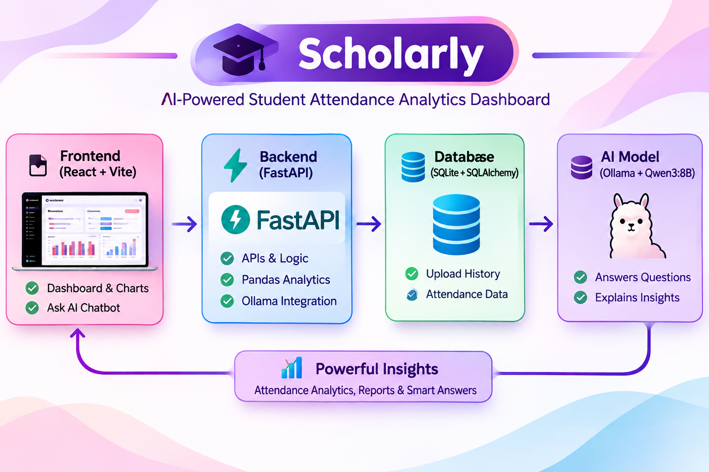
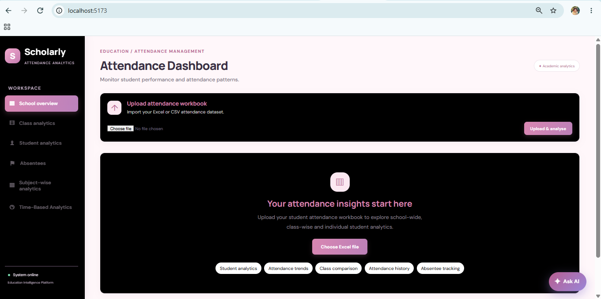
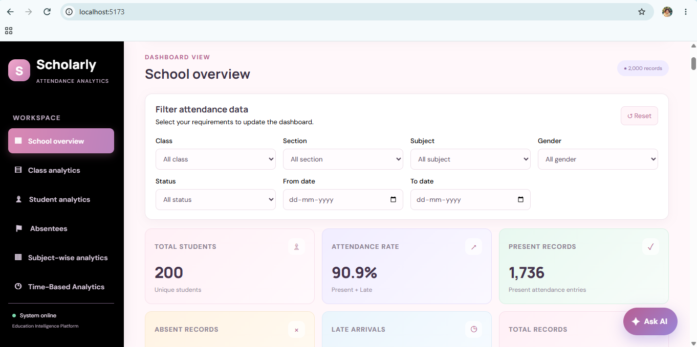
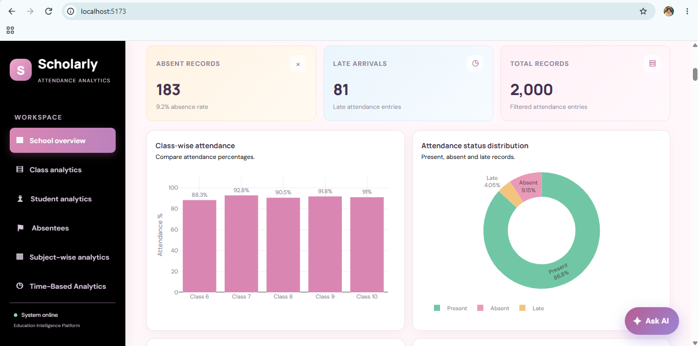
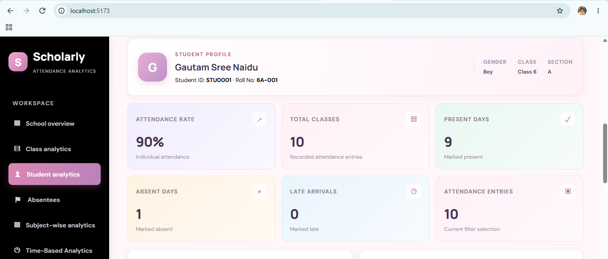
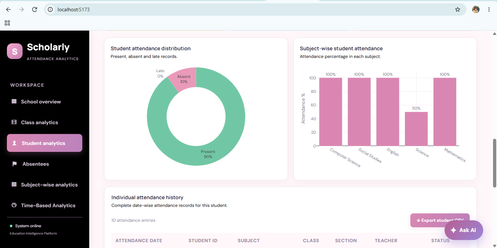
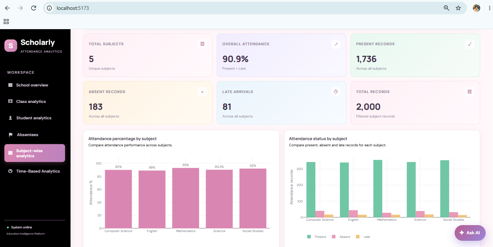
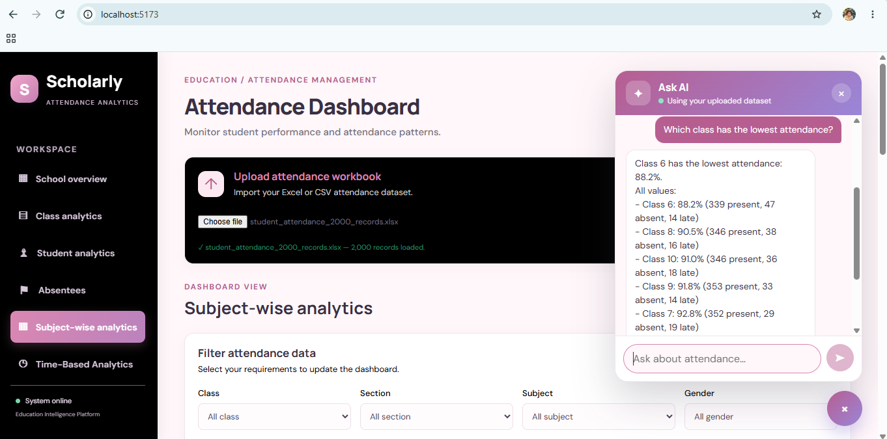

# Scholarly – AI-Powered Student Attendance Analytics Dashboard

## About the Project

Scholarly is an AI-powered student attendance analytics dashboard.

Think of it like this: a school has a lot of student attendance records in Excel files. It can be difficult to check every student, class, and subject manually.

So, I built this dashboard to make that work easier.

The user uploads an Excel or CSV attendance file. The application processes the data and displays useful information through charts, tables, and statistics.

It also has an AI chatbot called **Ask AI**. Users can ask questions about their uploaded attendance data and get answers.
## Project Architecture



## Dashboard Screenshots

### 1. Attendance Dashboard

This is the starting page where users can upload their attendance Excel or CSV file.



### 2. School Overview

This page shows the overall school attendance information, including total students, attendance percentage, present records, absent records, and late arrivals.




### 3. Class Analytics

### 4. Student Analytics

This page shows individual student information, attendance percentage, present days, absent days, late arrivals, and attendance history.




### 5. Subject-Wise Analytics

This page compares attendance percentages and attendance records across different subjects.



### 7. AI Chatbot – Ask AI

Users can ask questions about attendance data using the AI chatbot.



---

## Main Features

### 1. Upload Attendance Data

- Upload Excel files (`.xlsx`).
- Upload CSV files (`.csv`).
- Process attendance records using Pandas.
- Clean and analyse uploaded data.
- Download cleaned attendance data as a CSV file.

### 2. School Overview

- Total number of students.
- Overall attendance percentage.
- Present attendance records.
- Absent attendance records.
- Late attendance records.
- Total attendance records.
- Class-wise attendance charts.
- Attendance status distribution.

### 3. Class Analytics

- Compare attendance across classes.
- View class-wise attendance percentages.
- Analyse present, absent, and late records.

### 4. Student Analytics

- View individual student profiles.
- Search and check student information.
- View student attendance percentages.
- Check present, absent, and late days.
- View individual attendance history.
- Export student attendance history as CSV.

### 5. Absentee Tracking

- Identify students with repeated absences.
- View absentee information.
- Find students who need attendance follow-up.
- Export absentee follow-up information.

### 6. Subject-Wise Analytics

- View the number of subjects.
- Compare attendance percentages across subjects.
- Compare present, absent, and late records.
- View subject-wise charts.

### 7. Time-Based Analytics

- Daily attendance analysis.
- Weekly attendance analysis.
- Monthly attendance analysis.
- Weekday attendance comparison.
- Attendance movement over the selected period.

### 8. Filters

Users can filter attendance information using:

- Class
- Section
- Subject
- Gender
- Attendance status
- From date
- To date

### 9. AI Chatbot – Ask AI

The dashboard includes an AI chatbot that helps users understand their attendance data.

Users can type questions in normal English.

Example questions:

- Which class has the lowest attendance?
- Show students below 75% attendance.
- Which students are absent most often?
- Which weekday has the lowest attendance?
- What is the overall attendance percentage?
- How many students are there?
- How is attendance calculated?
- How do I upload attendance data?

The chatbot uses **Qwen3:8B through Ollama**.

Python Pandas calculates attendance numbers from the uploaded data. The AI model helps understand questions and explain the results in simple language.

If Ollama is unavailable, the application can still return answers from its built-in Pandas calculation rules for supported questions.

---

## Technologies Used

| Technology | Purpose |
|---|---|
| React.js | Building the frontend |
| Vite | Running the frontend development server |
| JavaScript | Frontend functionality |
| CSS | Dashboard design and styling |
| Axios | Connecting frontend to backend |
| Plotly | Creating charts and graphs |
| Python | Backend programming |
| FastAPI | Creating backend APIs |
| Pandas | Cleaning and analysing attendance data |
| OpenPyXL | Reading Excel files |
| SQLAlchemy | Database connection and operations |
| SQLite | Storing upload history |
| Ollama | Running the local AI model |
| Qwen3:8B | Understanding and answering user questions |
| HTTPX | Connecting the backend to Ollama |

---

## How the Project Works

The project works in these simple steps.

**Step 1 – Upload the file**

The user selects an Excel or CSV attendance file from the dashboard.

**Step 2 – Send the file to the backend**

React sends the uploaded file to the FastAPI backend using Axios.

**Step 3 – Process the data**

FastAPI receives the file. Python Pandas reads, cleans, and analyses the attendance records.

**Step 4 – Store upload information**

SQLAlchemy saves the uploaded file information and attendance summary in the SQLite database.

**Step 5 – Show dashboard results**

The backend sends the processed results to React. React displays the information using cards, tables, filters, and Plotly charts.

**Step 6 – Ask questions using AI**

The user opens the Ask AI chatbot and types a question.

The backend uses Pandas to calculate the required attendance information. Ollama with Qwen3:8B helps understand questions and explain the results.

---

## Project Architecture

```text
                 USER
                   |
                   v
             REACT FRONTEND
                (VITE)
                   |
                   v
             FASTAPI BACKEND
                   |
                   v
             PANDAS ANALYTICS
                   |
           +-------+--------+
           |                |
           v                v
      ATTENDANCE         SQLITE DATABASE
      PROCESSING         UPLOAD HISTORY
           |
           v
      DASHBOARD RESULTS
           |
           v
       REACT DASHBOARD
           |
           v
        ASK AI CHATBOT
           |
           v
        FASTAPI /api/ask
           |
           v
       PYTHON LLM MODULE
           |
           v
        OLLAMA SERVER
           |
           v
        QWEN3:8B MODEL
           |
           v
       AI ANSWER
           |
           v
       CHAT INTERFACE
```

---

## Project Folder Structure

```text
ai_business_intelligence_dashboard/
│
├── backend/
│   ├── __init__.py
│   ├── main.py
│   ├── analytics.py
│   ├── database.py
│   ├── models.py
│   ├── llm.py
│   ├── requirements.txt
│   └── .env
│
├── frontend/
│   ├── src/
│   │   ├── components/
│   │   │   └── AIChatbot.jsx
│   │   ├── App.jsx
│   │   └── styles.css
│   ├── package.json
│   └── index.html
│
├── docs/
│   └── images/
│       ├── Attendence_dashboard.png
│       ├── School_overview_dashboard1.png
│       ├── SOD2.png
│       ├── Student_profile_dashboard.png
│       ├── SPD2.png
│       ├── Subject_wise_analytics.png
│       └── AI_Chatbot_QA.png
│
├── .gitignore
└── README.md
```

---

## Installation and Setup

### Requirements

Install these tools before running the project:

- Python
- Node.js and npm
- Git
- Ollama

### Step 1 – Clone the GitHub Repository

```bash
git clone https://github.com/lakshmiprasannaadi499-del/ai-school-analytics-attendance-dashboard.git

cd ai-school-analytics-attendance-dashboard
```

### Step 2 – Set Up the Backend

Create a Python virtual environment:

```bash
python -m venv venv
```

Activate it on Windows:

```bash
venv\Scripts\activate
```

Install the required Python packages:

```bash
pip install -r backend/requirements.txt
```

### Step 3 – Install and Run Ollama

Install Ollama from:

https://ollama.com/

Download the Qwen3:8B model:

```bash
ollama pull qwen3:8b
```

Make sure Ollama is running before testing the AI chatbot.

The default model configuration in `llm.py` is:

```env
LLM_MODEL=qwen3:8b
```

The default Ollama address is:

```env
LLM_BASE_URL=http://localhost:11434
```

These values can be configured in the backend environment.

### Step 4 – Run the Backend

Open a terminal in the main project folder and run:

```bash
uvicorn backend.main:app --reload --host 0.0.0.0 --port 8000
```

Backend URL:

http://127.0.0.1:8000

FastAPI API documentation:

http://127.0.0.1:8000/docs

### Step 5 – Run the Frontend

Open another terminal:

```bash
cd frontend
```

Install frontend packages:

```bash
npm install
```

Start the frontend:

```bash
npm run dev -- --host 0.0.0.0
```

Open the application:

http://localhost:5173

---

## Backend API Endpoints

| Method | API Endpoint | Purpose |
|---|---|---|
| GET | `/` | Check whether the backend is running |
| GET | `/api/health` | Check backend and dataset status |
| GET | `/api/llm/status` | Check Ollama and model status |
| POST | `/api/upload` | Upload and analyse attendance file |
| GET | `/api/students` | Get student information |
| GET | `/api/students/{student_id}/attendance` | Get individual attendance history |
| GET | `/api/history` | Get upload history |
| POST | `/api/ask` | Send questions to Ask AI |
| GET | `/api/download` | Download cleaned attendance CSV |

---

## Database

The project uses SQLite with SQLAlchemy.

The default database file is:

`attendance_dashboard.db`

The `attendance_uploads` table stores information about uploaded files, including:

- Filename
- Number of attendance records
- Number of students
- Present, absent, and late counts
- Attendance percentage
- Summary information
- Upload date and time

The currently active attendance analysis is kept in backend memory. It is not permanently stored as complete attendance records in SQLite.

---

## Important Notes

- The application accepts `.xlsx` and `.csv` files.
- The maximum upload size is 10 MB.
- Qwen3:8B runs locally through Ollama.
- The active attendance dataset is reset when the backend restarts. Upload the file again after restarting.
- SQLite stores upload history and summary information.
- Ollama must be running to use the model-based AI responses.

---

## Future Improvements

- Add user login and authentication.
- Support more file formats.
- Store complete attendance records permanently.
- Add PDF report generation.
- Add more advanced attendance analysis.
- Improve AI question answering.
- Deploy the application online.

---

## Author

**Lakshmi Prasanna Adi**

GitHub: https://github.com/lakshmiprasannaadi499-del

**Project:** Scholarly – AI-Powered Student Attendance Analytics Dashboard
